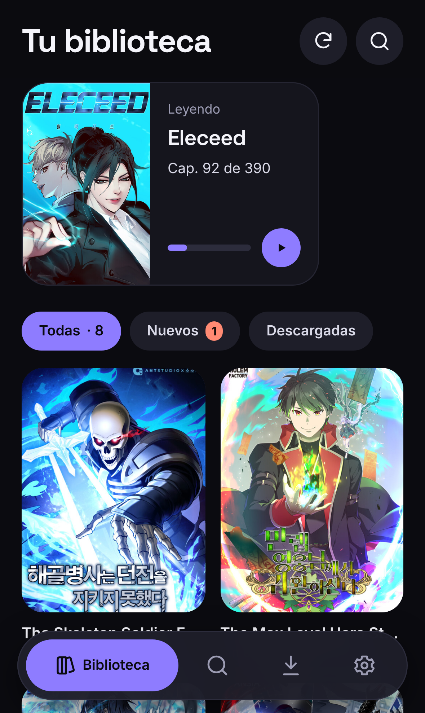
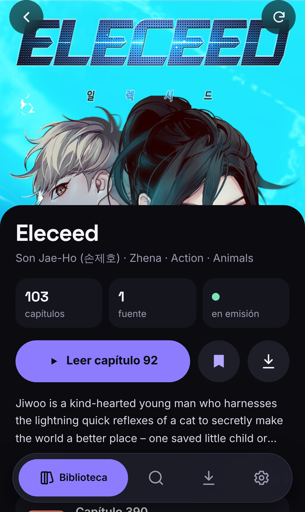
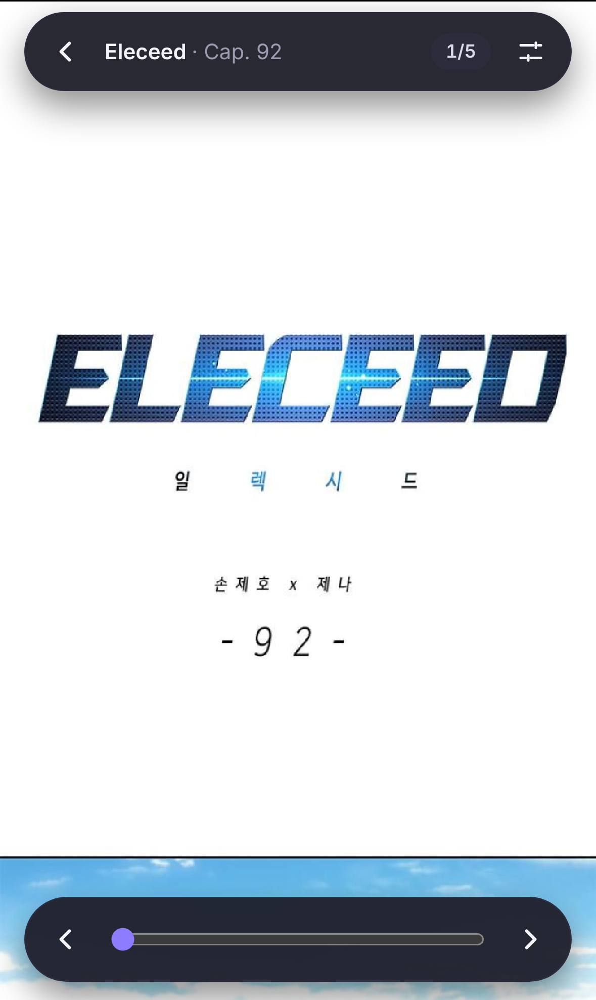
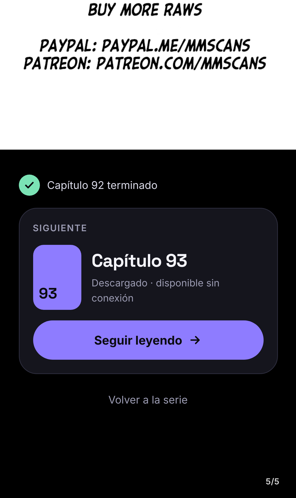

# Hanyo

Tu biblioteca personal de **manhwa, manga y manhua**: busca en varias fuentes a la vez, añade series a tu
biblioteca, recibe avisos de capítulos nuevos y descárgalos para leerlos sin conexión en el iPhone.

<p>
  
  
  
  
</p>

- **App**: PWA (SvelteKit) que se instala desde Safari → «Añadir a pantalla de inicio».
- **Servidor**: `hanyo-api` (Hono + SQLite) + Suwayomi (extensiones de Mihon) en el VPS de yoqze.
- **Fuentes**: MangaDex, Weeb Central, Comix, Asura Scans, Flame Comics.

Documentación: [arquitectura](docs/architecture.md) · [decisiones](docs/decisions.md) ·
[estado](docs/status.md) · [pendientes](docs/backlog.md) · [despliegue](docs/deploy.md)

## Desarrollo

```bash
npm install
npm run dev        # API en :3101 (contraseña por defecto en dev: "hanyo")
npm run dev:web    # PWA en :5173
```
