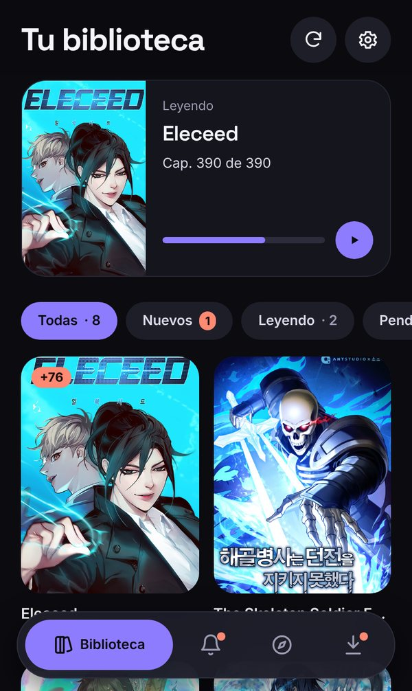
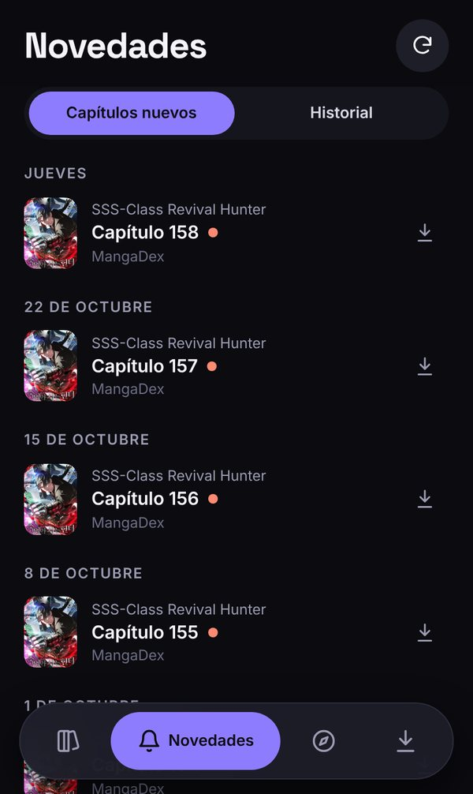
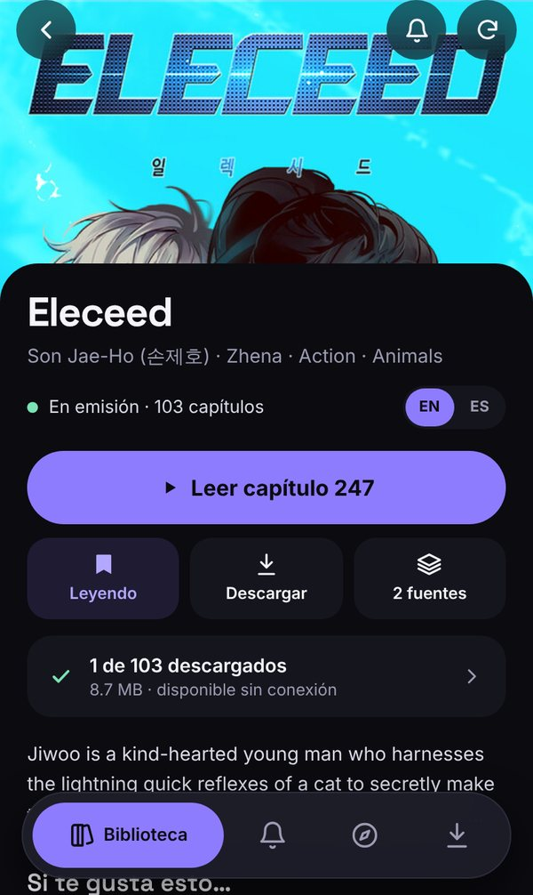

# Hanyo

A small, self-hosted library and offline reader for **manhwa, manga and manhua**, installed on the
iPhone as a PWA, for its owner and a few invited people.

Search many sources at once, keep your series in one library, get notified when new chapters come
out, and download chapters to read with no connection. Your progress is kept per chapter number, so
switching sources never loses your place. Each account has its own library and progress.

<p>
  
  
  
  
  
</p>

> The interface is in Spanish (the owner's language). Code, comments, commits and docs are in English.

> **Want an account?** Hanyo is private and invite-only. If you'd like your own personal account,
> write to me and ask: [open an issue](https://github.com/r3b0rNjHs/Hanyo/issues/new?title=Account%20request)
> or contact [r3b0rNjHs](https://github.com/r3b0rNjHs) on GitHub, and I'll send you an invite link.

## Features

**Accounts**
- Each person has their own library, lists, language and translation-group choices, read marks,
  history, stats and notifications. Nobody sees anyone else's.
- The catalogue (series, sources, chapters) and the server's image cache are shared, so a series one
  person reads is already linked and cached for the next, and sources are not asked twice.
- New accounts join through single-use invite links; admins manage accounts from the app
  (see [Accounts](#accounts)).
- Recommend a series to other accounts, with a short note; it reaches them as a notification and
  in their *Novedades*. Only usernames are visible to other accounts, never libraries.

**Library**
- Reading lists: *Leyendo*, *Pendiente*, *En pausa*, *Terminada*, with filters and sorting.
- One series, many sources: chapters are merged by number, the preferred source wins and the rest
  fill the gaps. Sources are linked automatically, including when new sources are installed.
- English or Spanish per series, switchable without losing progress.
- Preferred source and preferred translation group per series.
- New-chapter checks every few hours, with push notifications (per series, can be turned off).

**Discover**
- **Novedades**: the latest chapters of the series you follow, grouped by day, plus a reading
  **history** to pick up where you left off.
- **Explore**: AniList trends by origin (manhwa / manga / manhua), genre and order (trending,
  most popular, best rated), and each source's own popular and latest lists.
- **Search** across every source at once. Results are merged by AniList names, so the same series
  under different titles shows up once.
- "If you like this…" recommendations on every series page. Titles from AniList open straight into
  the matching series.

**Reading**
- Vertical strip reader for webtoons and a paged reader (right-to-left or left-to-right) for
  manga, with pinch and double-tap zoom.
- Resumes at the exact spot, even inside very tall strip pages.
- The next chapter is fetched while you read, so it opens instantly, even if the connection drops.
- Chapter list, brightness, keep-awake and page counter inside the reader.

**Offline**
- Download a chapter, the next ones, all unread or a whole series. Pages are re-encoded on the
  server (WebP/mozjpeg q90, about 80% smaller with no visible loss).
- Optional automatic download of the next unread chapters whenever the app is opened.
- The library, downloaded chapters and reading progress all work in airplane mode. Progress made
  offline syncs later.
- Free space by deleting one chapter, a series, everything already read, or all downloads.

**Stats and settings**
- Reading stats: streak, chapters per week, month and year, an activity calendar, most-read series
  and favourite genres.
- Light, dark and system themes.
- Daily source health check that notifies the admins when a source breaks or comes back, plus
  server stats in settings.

## Accounts

- **The admin.** On first start the existing data belongs to an admin account (`admin`, or
  `HANYO_ADMIN_USER`) whose password is `HANYO_PASSWORD`. Username and password can then be changed in
  *Ajustes → Cuenta*. Changing the password signs out every other device.
- **Getting an account.** There is no public sign-up: ask the owner (see the note at the top) and
  you'll receive an invite link.
- **Inviting someone.** *Ajustes → Cuentas → Invitar a alguien* opens the share sheet with a link.
  It works once and expires after 7 days; pending invites can be copied again or revoked. The person
  picks a username and password and starts with an empty library.
- **Managing accounts.** Admins see every account with its library size and last reading day, and
  can delete one. That removes its personal data and ends its sessions at once. The last admin can't
  be deleted.
- **Privacy on a shared phone.** Logging out clears the personal data the app cached on the device
  (library, history, pending progress). Downloaded chapters stay until removed in *Descargas*.
- **Security.** Passwords are stored as scrypt hashes, login and invite attempts are rate-limited, and
  session cookies are signed and carry a version that a password change invalidates.

## How it works

```
iPhone (PWA)
 ├─ SvelteKit SPA + service worker ── Cache Storage (app, API JSON, covers, downloaded pages)
 │                                    IndexedDB (downloads, download queue, offline progress)
 └─ HTTPS ─► Caddy (VPS)
              ├─ /       static PWA
              └─ /api/*  hanyo-api (Node, Hono, SQLite, PM2)
                           ├─ page proxy + re-encoding + size-capped disk cache
                           ├─ MangaDex provider ───► api.mangadex.org, MangaDex@Home
                           ├─ AniList ─────────────► titles, trends, recommendations
                           └─ Suwayomi provider ───► Suwayomi-Server (Docker, localhost only)
                                                      ├─ Mihon extensions (Keiyoushi)
                                                      ├─ FlareSolverr (Cloudflare challenges)
                                                      └─ optional Cloudflare WARP egress
```

- **Providers** share one interface. MangaDex is native; every other site is a Mihon extension run by
  [Suwayomi-Server](https://github.com/Suwayomi/Suwayomi-Server), which is never exposed publicly.
- **The phone only talks to hanyo-api.** Page URLs are stable, same-origin and cached, so a downloaded
  chapter is served by the service worker exactly as if it were online.
- **AniList** supplies every known name of a series. It is used to merge search results, link
  sources and open trending titles. If AniList is unavailable, everything still works without it.

More detail: [architecture](docs/architecture.md) · [decisions (ADRs)](docs/decisions.md).

## Tech stack

| Part | Stack |
| --- | --- |
| API (`apps/api`) | Node 22, TypeScript (ESM, strict), Hono, better-sqlite3, zod, sharp, web-push, vitest |
| Web (`apps/web`) | SvelteKit 2 (static SPA), Svelte 5 runes, Tailwind CSS v4, idb, Playwright |
| Shared types | `packages/types` (type-only DTOs) |
| Server | Ubuntu VPS, Caddy, PM2, Docker (Suwayomi, FlareSolverr, optional WARP) |
| CI | GitHub Actions: typecheck, unit tests, build, end-to-end tests; optional deploy on `main` |

## Repository layout

```
apps/api/src/
  providers/   mangadex, suwayomi, demo (offline test source), registry
  services/    library, users, pages, updates, anilist, health, stats, image-cache, push, compress
  app.ts       HTTP routes under /api (cookie auth)
apps/web/src/
  routes/      library, updates, stats, explore, search, series, reader, downloads, settings,
               login, invite
  lib/         reader views, offline downloads, components, API client
  e2e/         Playwright tests (apps/web/e2e)
deploy/        VPS setup and deploy scripts, docker-compose (+ WARP override), Caddy site, extensions list
docs/          architecture, decisions, status, backlog, deploy runbook, screenshots
```

## Getting started

Requirements: Node 22 and npm. Docker is only needed to try Suwayomi sources locally.

```bash
npm install
cp .env.example .env
npm run dev       # API on http://localhost:3101 (dev login: admin / hanyo)
npm run dev:web   # PWA on http://localhost:5173 (proxies /api)
```

MangaDex works out of the box. To add the other sources locally:

```bash
docker compose -f deploy/docker-compose.yml up -d
python3 deploy/bootstrap-extensions.py   # installs the extensions in deploy/extensions.txt
```

### Configuration

All settings are environment variables (see [`.env.example`](.env.example)):

| Variable | Default | Purpose |
| --- | --- | --- |
| `HANYO_PASSWORD` | `hanyo` in dev, required in prod | Initial password of the admin account |
| `HANYO_ADMIN_USER` | `admin` | Username of the admin account on first start |
| `SESSION_SECRET` | dev value, required in prod | Signs the session cookie and image URLs |
| `DATA_DIR` | `./data` | SQLite database and image cache |
| `API_PORT` | `3101` | API port (bound to 127.0.0.1) |
| `IMAGE_QUALITY` | `90` | Re-encoding quality for pages; `0` keeps originals |
| `IMAGE_CACHE_MAX_MB` | `8000` | Disk budget for cached pages and covers |
| `SUWAYOMI_URL` | `http://127.0.0.1:4567` | Local Suwayomi-Server |
| `SUWAYOMI_LANGS` | `en,es` | Source languages to use |
| `SUWAYOMI_SOURCES` | *(all)* | Restrict to these Suwayomi source ids |
| `UPDATE_INTERVAL_MIN` | `180` | New-chapter check interval; `0` disables |
| `VAPID_PUBLIC_KEY` / `VAPID_PRIVATE_KEY` / `VAPID_SUBJECT` | *(empty)* | Web push (`npx web-push generate-vapid-keys`) |
| `HANYO_DEMO_SOURCE` | *(unset)* | `1` replaces all sources with an offline demo source (tests) |

## Testing

```bash
npm run typecheck                         # every workspace
npm test                                  # unit tests (vitest)
npm run build && npm run e2e -w apps/web  # end-to-end (Playwright, offline demo source)
```

The end-to-end suite runs the real API and the built PWA against a demo source with generated
pages. It covers search, reading lists, strip and paged reading, the prefetched next chapter and
downloads read offline, Novedades, history, stats, Explore, settings, and accounts (login, invites,
isolated libraries, deleting an account). CI runs everything on every pull request.

## Deployment

Runs on a single VPS next to other services: Caddy serves the PWA and proxies `/api`, PM2 runs
hanyo-api, and Docker runs only Suwayomi and FlareSolverr.

- First install: `deploy/setup.sh` (see the [deploy runbook](docs/deploy.md)).
- Updates: `sudo -u deploy bash /home/deploy/hanyo/deploy/deploy.sh`. It pulls `main`, builds,
  publishes the PWA, restarts the API and syncs the extensions in `deploy/extensions.txt`.
  GitHub Actions can run it on every push to `main` once `DEPLOY_ENABLED` and the SSH secrets are set.
- Sites that block datacenter IPs: optional Cloudflare WARP egress for Suwayomi
  (`deploy/docker-compose.warp.yml`, ADR-010).
- `deploy/test-sources.py` checks which extensions actually work from the server.

## Sources and responsible use

Hanyo is a private reader for its owner and a few invited people; there is no sign-up and no public
catalogue, and it hosts no content of its own. It respects the MangaDex API rate limits and reports
MangaDex@Home delivery as required, fetches each page once for everyone (shared cache), keeps the
cache size-capped, and checks sources once a day. Please support the official releases of the
series you enjoy.

## Documentation

[Architecture](docs/architecture.md) · [Decisions](docs/decisions.md) · [Status](docs/status.md) ·
[Backlog](docs/backlog.md) · [Deploy runbook](docs/deploy.md)
